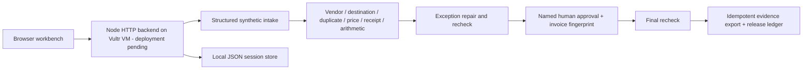

# Dockcheck

An exception-first procurement workbench. Dockcheck compares an invoice with the purchase order, receipt and vendor registry, routes discrepancies to a reviewer, and exports an evidence packet only after a named approval. A changed account, an unreceived quantity or a repeated invoice becomes a visible stop rather than an unnoticed release.

**Current status: working local prototype; not deployed or submitted.** Built from scratch on November 4, 2026 for the Vultr Agent Rush **Powering the Future of Work** track. No Handoff Ledger code or data was reused. AI tools assisted design, implementation and testing; the submitted workflow itself is deterministic. Optional local model briefing is disabled and unverified in this build.

## Run

Requires official Node.js22 or later. No package installation, API key, account, database service or container is required.

```sh
npm start
```

Open http://127.0.0.1:8191. ```sh
npm test
npm run check
```

All names, invoices, orders, receipts and bank suffixes are synthetic. Use a synthetic reviewer name. The app exports JSON review evidence; it never sends money, contacts vendors or performs real bank verification.

## Try the consequential paths

1. Create **Partial delivery**: 100 units billed, only80 received. The $2,400 invoice fails the receipt check. Approval and export are blocked.
2. Correct to the received quantity. The current invoice becomes $1,920; original intake evidence stays in the run. The trace records the $480 reduction and repeated checks.
3. Enter a reviewer name and a specific review note. Approval binds to a SHA-256 fingerprint of the exact current invoice.
4. Export and download the evidence. Retrying export returns the same packet identifier and does not append a second ledger entry.
5. Try **Changed bank details**: restore the registered synthetic account before approval. Try **Repeated invoice**: this is a hard stop with no override.
6. Open another browser session: its queue is separate. Restart the server: the first session retains its work if its session cookie is retained.

## Architecture



The backend owns reference data, checks, task state, approval, replay protection and persistence. The client displays returned state; disabling a button is never the only protection. Session cookies are random, HttpOnly and SameSite=Strict. Cross-origin writes are rejected. Revision guards reject stale edits. Public deployment must use HTTPS and `COOKIE_SECURE=1`.

`workflow.mjs` holds the domain transitions; `server.mjs` exposes the API; `public/` is the dependency-free interface; `test/` exercises HTTP and critical domain failures. State is saved atomically to `data/workspaces.json`, excluded from source publication. The single-process JSON store is a prototype choice, not an enterprise database.

## AI honesty and limits

The challenge explicitly permits rule-based workflows. This version does not claim autonomous reasoning, OCR, ERP integrations, verified monetary savings or live payment execution. A disabled optional adapter can ask an existing local `qwen3.6:latest` model for a reviewer explanation. It has no approval or export authority. This adapter has not been inference-tested for Dockcheck and must not be shown as a working feature in the submission. No model endpoint is contacted in the default configuration. Do not enable it without an authorized, verified local endpoint.

The demo identity is a reviewer label, not authentication or role-based access control. Sessions isolate synthetic demonstrations, not real tenant data. The server caps each session at40 runs and retains at most100 sessions. Production work requires real identity/roles, durable multi-process storage, ERP import, approval separation and operations monitoring.

## Verification and submission status

Seven automated tests pass on Node v24.22.1, covering invoice correction, exact-revision approval, blocked duplicate handling, export idempotence, session isolation, persistence, rejected invalid/cross-origin writes, and unavailable optional inference. Syntax checks pass for the backend, workflow and browser client.

The application has **not yet been verified on Vultr or submitted**. Public HTTPS deployment, a genuine recorded demonstration and the final entry receipt remain outstanding. A successful local test is not deployment evidence.

## Deployment

Node 22 or later and one process are sufficient. No package installation, Docker, GPU or paid/model API is required. Keep the default deterministic mode. The included service template expects an authorized Linux host, an unprivileged service account, `/opt/dockcheck`, and a verified Node executable path. Run the app with `HOST=127.0.0.1 PORT=8191 COOKIE_SECURE=1` behind a real HTTPS reverse proxy that preserves Host. Keep the backend port private. The single-process JSON store is not suitable for multi-writer deployment.

## License

MIT. See [LICENSE](LICENSE).
